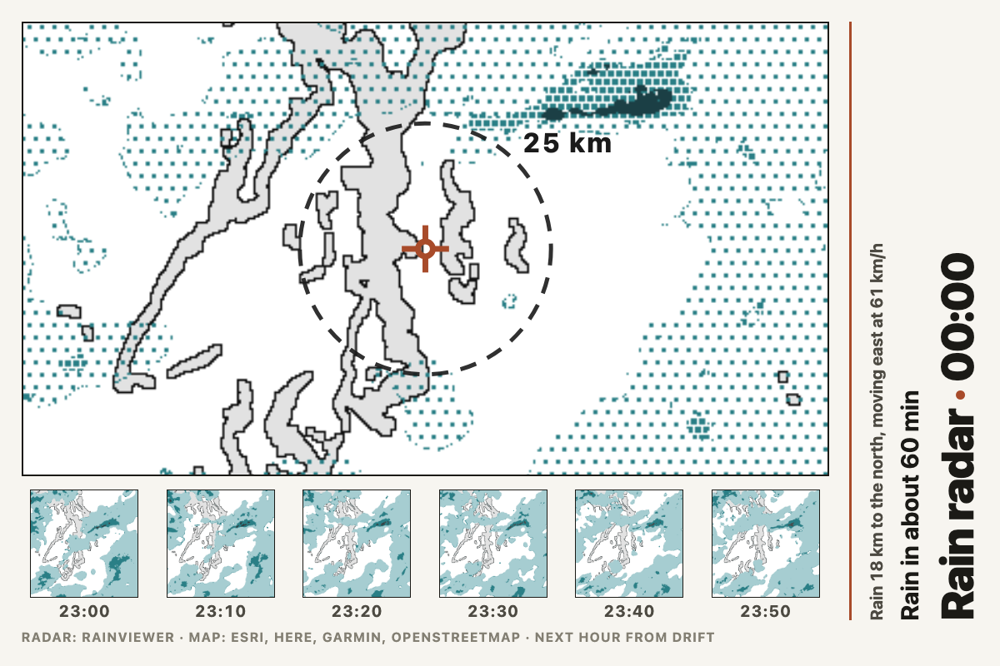
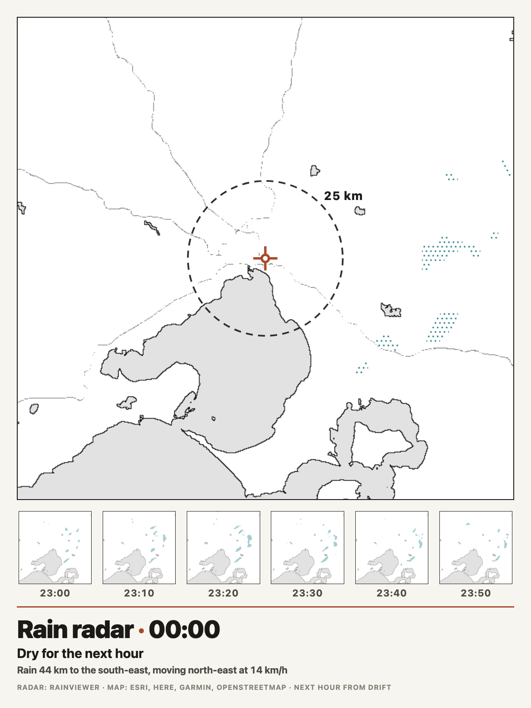
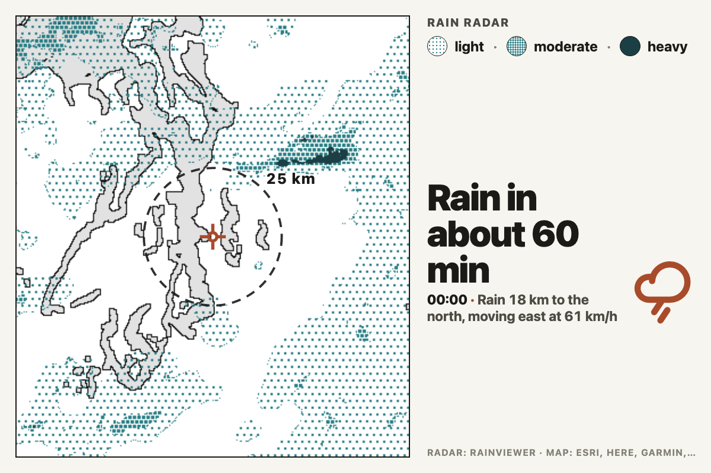
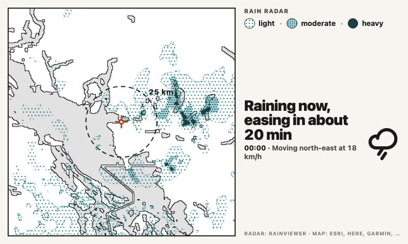
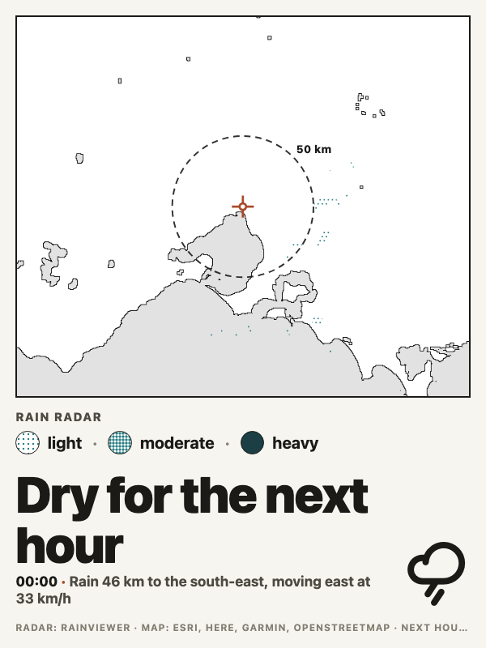
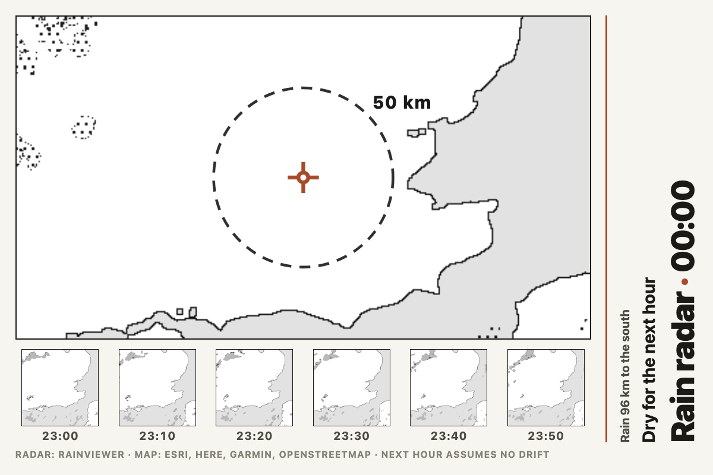
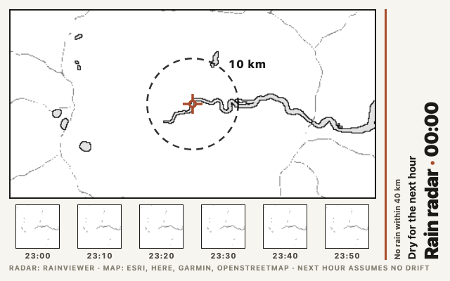
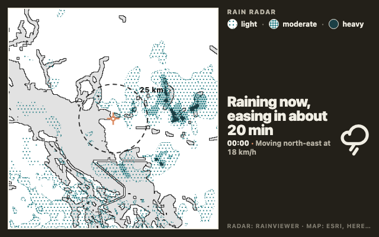
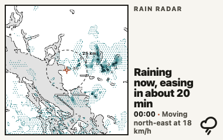
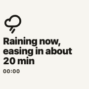

# rain_radar

The rain radar around the panel, drawn as a printed map: a label-free coast,
water and main roads with the latest echoes stippled over them in three
intensities, a range ring and a home mark, the last hour as a strip of small
frames, and a plain-words headline such as "Rain in about 20 min" or "Dry for
the next hour".

*Seattle at 1200x800, the Map and strip layout, 100 km. Light rain is the
sparse stipple, moderate the dense one, heavy the solid dark teal.*

## Where the data comes from

**Radar** is RainViewer's public weather-maps API, which needs no key. It
lists the last two hours of composite radar at ten-minute steps and serves
each frame as map tiles. Two limits shape this widget:

- The public tier serves tiles up to zoom 7 only, about half a kilometre a
  pixel at 512 px tiles. That is finer than any e-ink panel shows at the
  ranges on offer, but it is why the echoes have soft, slightly blocky edges
  when a 50 km view is blown up on a large panel.
- The index no longer carries nowcast frames on the public tier. When it
  does, the headline uses them. When it does not, the widget works out the
  drift of the echoes from the last half hour (sliding one frame over
  another and keeping the best overlap), pushes the latest frame along that
  drift for the next sixty minutes, and reads what lands within ten
  kilometres of home. That is a modelled extrapolation, not a forecast, and
  the foot of the page says so ("Next hour from drift"). Where nothing has
  moved enough to measure, the headline assumes the echoes stay put and says
  "Next hour assumes no drift".

RainViewer's tiles are classified by colour. The server answers in the
Universal Blue scheme whichever scheme number is asked for, and the smoothed
tiles still use one exact colour per dBZ step, so each pixel's reflectivity
is a table lookup. The bands are light (10 to 27 dBZ, drizzle to about a
millimetre an hour), moderate (28 to 39 dBZ) and heavy (40 dBZ and up, about
ten millimetres an hour or more). Anything under 10 dBZ is dropped as clutter.

**Coverage depends on the national radar networks RainViewer aggregates.**
Australia, New Zealand, North America, Europe, Japan and a few other
countries are well covered; much of the world has no radar at all, and the
widget will say "Dry for the next hour" over a place that simply has no
radar. RainViewer's free API is for non-commercial display with attribution;
the page carries "Radar: RainViewer".

**Base map** tiles come from Esri's Light Gray Canvas (the base layer, which
has no labels above zoom 8). The server thresholds the grey tiles into paper,
light grey water with a black coastline and thin grey roads, so the map
dithers cleanly on any panel. At the two lowest zooms the layer carries
country and state names in the same grey as water; those are removed with a
small morphological opening, which also drops the thinnest rivers at those
zooms. CARTO's basemaps, the usual label-free choice, now answer every
request with an "API key required" card, which is why Esri is used.

Tile services change their terms, so the widget does not depend on this one.
When the Esri tiles do not arrive, or come back as a placeholder card rather
than a map, the coast is drawn offline instead from
[Natural Earth](https://www.naturalearthdata.com/) 1:10m land, minor islands
and the larger lakes (public domain), packed into `land.bin` (about 550 kB)
beside `server.py` by `tools/pack_land.py`. That coastline is simplified to
about 650 m and has no roads, so it is coarser than the tiles at 50 km, but
the map keeps its shape, and the foot of the page then reads "Map: Natural
Earth".

Base tiles are kept a week and radar tiles two hours under the widget's data
folder. A render makes at most 40 tile requests, fetched in parallel; when a
first render at 200 km on a large panel needs more than that, the oldest
frames of the strip wait for the next refresh and a small notice says so.

## What it shows

Home is at the centre, marked with a cross in the theme's alert colour. The
dashed ring is a tenth, a quarter or a half of the range (10, 25 or 50 km),
so distances on the map can be read at a glance. The short side of the cell
spans the range chosen; the map is cropped from a square covering 1.6 times
the range, so a wide cell shows more country to the sides.

The headline is one of: "Rain in about N min", "Heavy rain in about N min",
"Raining now, easing in about N min", "Raining now, set in for the hour",
"Light rain now, easing within the hour", or "Dry for the next hour". Beneath
it, the nearest rain on the map by distance and compass point, and how the
echoes are moving ("Rain 18 km to the north, moving east at 61 km/h"), or
"No rain within 80 km" when the map is clear.

Times are the frame times from RainViewer, shown in the place's time zone
when the place was picked in the editor's location search, and in the
server's zone otherwise.

## Two layouts

**Map and strip** (the default) puts the map in a ruled frame with the last
hour as a strip of frames beneath it, and the title, time and headline set
along the right edge reading bottom to top. On a portrait cell the caption
runs under the strip instead.

*Melbourne on a 13.3" portrait panel (1200x1600): the caption moves under the
strip. A dry evening with showers 44 km to the south-east.*

**Map and headline** gives the headline the room: the map square, a legend of
the three stipples, and the headline large with the time and a rain-cloud icon.

*Seattle at 1200x800, the Map and headline layout: "Rain in about 60 min".*

*Vancouver on an 800x480 panel (Inky Impression 7.3", Waveshare E6): rain
over home, easing in about 20 minutes on the measured drift.*

*Melbourne in a 600x800 cell (a quarter of a 13.3" panel) at 200 km, the
headline layout stacked for portrait.*

## Ranges and colours

*London at 200 km with the Ink colour for a black and white panel: rain is
black stipple, the ring is 50 km. The strip is the last hour over the
Channel.*

*London at 640x400 and 50 km, the ring at 10 km. The Thames and the main
roads come through from the base map; a dry hour.*

*Vancouver at 640x400 in the dark theme. The map is a literal picture and
stays paper-white inside its frame; the type and the mark take the theme's
colours.*

## Small cells

*sm (380x240): the map and the headline, nothing else.*

*xs (180x180): the headline alone with the frame time.*

## Built for e-ink

Everything on the map is one of a handful of literal colours: white paper,
one light grey for water, black line work, and two teals (or two blacks)
for rain, drawn as stipple rather than tints. Light rain is a sparse field
of 2 px squares, moderate a dense field of 3 px squares, heavy is solid, so
the three bands survive a two-colour panel without relying on hue. The
widget declares `design.palette: extended` because of those literal
colours; the type and the frame use the Spectra tokens.

Nothing animates, no fonts are loaded, and the whole picture is made on the
server with Pillow, so the browser only lays out an image, a strip of
thumbnails and a few lines of text.

## Options

Place, range and layout are always shown; the rest sit under **More
options**.

| Option | Notes |
| --- | --- |
| Place | Home, at the centre of the map. Falls back to the app-level location. |
| Within | 50, 100 or 200 km across the short side of the cell. The ring is drawn at a tenth, a quarter or a half of it. |
| Layout | Map and strip, or Map and headline. |
| How many frames | More options. 4, 6 or 8 past frames in the strip, ten minutes apart. |
| Rain colour | More options. Teal for colour panels; Ink draws the rain in black for a black and white panel. |
| Title | More options. The words before the time; blank shows the place. |

## Requirements

Pillow in Tesserae's Python environment (it ships with Tesserae). Network
access to `api.rainviewer.com`, `tilecache.rainviewer.com` and
`server.arcgisonline.com`, declared in the manifest. Without the last the
widget still draws, with the offline coastline.

## Licence

AGPL-3.0. See [LICENSE](LICENSE).

Radar data and tiles from [RainViewer](https://www.rainviewer.com/api.html),
free for non-commercial use with attribution. Base map tiles from Esri's
[Light Gray Canvas](https://www.arcgis.com/home/item.html?id=ed712cb1db3e4bae9e85329040fb9a49):
Esri, HERE, Garmin, (c) OpenStreetMap contributors, and the GIS user
community. Offline coastline from [Natural Earth](https://www.naturalearthdata.com/)
(public domain). The widget shows "Radar: RainViewer" and the map credit on
the page.
